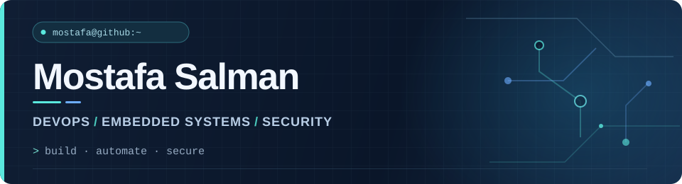

  

### `$ whoami`

Hi, I'm **Mostafa** — an Information Engineer based in Hamburg, Germany.

I build **CI/CD automation, developer tooling, and reliable workflows for embedded systems**, with a focus on DevOps and security engineering. At **NXP Semiconductors**, I work on engineering infrastructure for secure-element development and hardware-in-the-loop testing.

[**Portfolio**](https://mostafa-salman.me) · [**Public repositories**](https://github.com/Mose-Salman?tab=repositories&type=public)

### `$ ls ~/focus`

- **Platform engineering** — CI/CD · Kubernetes · Terraform · Observability
- **Embedded systems** — Linux · Python · C/C++ · Hardware-in-the-loop
- **Security engineering** — PKI · HSM · Secure elements

